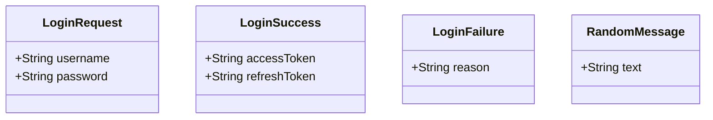
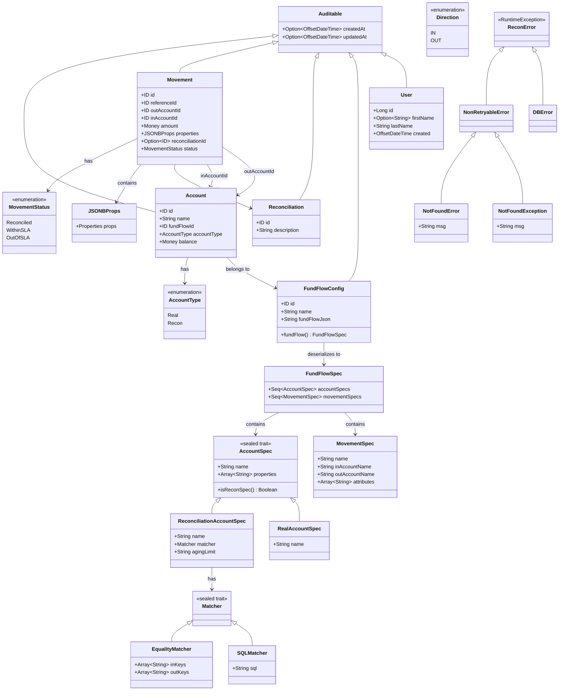

# PerfectPair Model Class Diagram

## perfectpair.model (Shared Models)

## perfectpair.domain.model (Domain Models)

## Type Aliases

| Alias | Type |
|-------|------|
| `ID` | `UUID` |
| `Money` | `BigDecimal` |
| `Properties` | `Map[String, String]` |
| `Tags` | `Map[String, String]` |

## Relationships Summary

- **Account** belongs to a **FundFlowConfig** via `fundFlowId`
- **Movement** references two **Accounts** (`inAccountId`, `outAccountId`)
- **Movement** optionally references a **Reconciliation** via `reconciliationId`
- **FundFlowConfig** contains serialized **FundFlowSpec** as JSON
- **FundFlowSpec** defines the structure with **AccountSpec** and **MovementSpec**
- All main entities extend **Auditable** for timestamp tracking